# Uncertainty-Aware 3D Urban Underground Infrastructure Digital Twin
### Utility Conflict Detection & Probabilistic Excavation Risk Prediction
**Institution:** RV College of Engineering (RVCE), Bengaluru, Karnataka, India  
**Target Publication:** Academic Journal Research Manuscript (Automation in Construction / ASCE Journal of Computing in Civil Engineering)  
**Geographical Scope:** Bengaluru Urban District (Primary Pilot Corridor: RVCE – Mysore Road SH-17, BBMP Ward 131)  

---

## 1. Project Abstract & Motivation

Urban subsurface utilities across Indian metropolitan cities—specifically **potable water supply networks, stormwater/sewer conduits, high-voltage electrical cables, and city gas distribution pipelines**—frequently suffer catastrophic mechanical excavation strikes during road remodeling, metro construction, and civic maintenance. The primary underlying cause is severe information asymmetry: legacy municipal utility records are predominantly 2D schematic CAD drawings or unindexed paper archives lacking verified 3D vertical burial depths, geodetic control, and positional variance bounds.

This research project presents a fully functional, mathematically rigorous, research-grade **3D Underground Infrastructure Digital Twin** that:
1. Ingests and harmonizes authentic multi-source geospatial datasets across Bengaluru civic agencies (**BWSSB, BESCOM, BBMP, KSRSAC/K-GIS, GAIL Gas, and OpenStreetMap**).
2. Implements a multi-factor **Statistical Confidence Model** adhering to **ASCE 38-22 Standard Guidelines for Subsurface Utility Engineering** while rigorously separating documented physical quality levels (QL-A to QL-D) from model-generated confidence classes.
3. Formulates an **IRC:98-2011 Engineering Depth Estimation Hierarchy** that strictly distinguishes *measured physical depths* from *inferred normative cover priors*.
4. Renders an interactive WebGL 3D digital twin in **Three.js** depicting soil strata cutaways, color-coded infrastructure networks, and **95% Gaussian translucent 3D uncertainty ellipsoids/envelopes**.
5. Conducts **3D Spatial Conflict Detection** and **Monte Carlo probabilistic strike simulations** ($N = 1,000$ iterations) against user-defined excavation trench volumes.
6. Delivers an **Explainable Machine Learning Risk Assessment Engine** (Random Forest, Gradient Boosting, Logistic Regression) with SHAP-style local feature attribution.
7. Validates performance across **six reproducible empirical research experiments** (data fusion RMSE, uncertainty calibration, false negative prevention, classifier benchmarking, parametric dispersion sensitivity, and selective layer omission impact).

---

## 2. System Architecture

```mermaid
flowchart TD
    subgraph S1["1. Authentic Bengaluru Data Sources"]
        A1["BWSSB Water Network (KML/WFS)"]
        A2["BWSSB Sewerage & Manholes (SHP)"]
        A3["BESCOM 11kV Feeders (DWG/GIS)"]
        A4["GAIL Gas CGD Corridors (KML)"]
        A5["BBMP Road & SWD Drains (GeoJSON)"]
        A6["KSRSAC K-GIS Geoportal (GPKG)"]
        A7["OSM Infrastructure Basemap"]
    end

    subgraph S2["2. Data Ingestion & Preprocessing"]
        B1["CRS Detection (WGS84 EPSG:4326 vs UTM 43N EPSG:32643)"]
        B2["Geometry Validation & Attribute Normalizer"]
        B3["Standardized Utility Schema Storage (SQLite Spatial)"]
    end

    subgraph S3["3. Scientific Computation Core"]
        C1["ASCE 38-22 Multi-Factor Confidence Scoring"]
        C2["IRC:98-2011 Hierarchical Depth Inferrer"]
        C3["3D Gaussian Covariance & Uncertainty Ellipsoids"]
        C4["Bayesian Weighted Geospatial Fusion Engine"]
    end

    subgraph S4["4. Excavation & Decision Engines"]
        D1["3D Prism Intersection & Clearance Buffer Engine"]
        D2["Monte Carlo Probabilistic Strike Simulation (N=1000)"]
        D3["Ensemble ML Excavation Risk Predictor (RF/GB/LR)"]
        D4["Engineering Decision Support & Directives Generator"]
    end

    subgraph S5["5. Visualization & Research Interface"]
        E1["Interactive 2D GIS Bengaluru Ward Map (Leaflet)"]
        E2["Interactive 3D Subsurface WebGL Twin (Three.js)"]
        E3["Research Validation Experiments Suite (Exp 1 - 6)"]
        E4["Executive Engineering Safety Report (JSON / Print)"]
    end

    S1 --> S2
    S2 --> S3
    S3 --> S4
    S4 --> S5
```



---

## 3. Mathematical & Engineering Formulations

### 3.1 Multi-Factor Confidence Score ($S_{\text{conf}}$)
Rather than assigning heuristic confidence percentages, our system computes an explainable composite index:
$$S_{\text{conf}} = w_1 R_s + w_2 C_{\text{attr}} + w_3 A(\Delta t) + w_4 \left(1 - \frac{\sigma_h}{\sigma_{h,\max}}\right) + w_5 \left(1 - \frac{\sigma_z}{\sigma_{z,\max}}\right)$$

- $R_s \in [0, 1]$: Source agency reliability weight (e.g., QL-A Vacuum test-hole = 0.98; QL-B GPR survey = 0.88; QL-D uncalibrated CAD = 0.65).
- $C_{\text{attr}} \in [0, 1]$: Attribute completeness index (evaluates presence of nominal diameter, material class, installation era, and depth status).
- $A(\Delta t) = \exp(-\lambda \cdot \Delta t)$: Temporal age decay ($\lambda = 0.015$, $\Delta t = t_{\text{current}} - t_{\text{install}}$).
- $\sigma_h, \sigma_z$: Standard deviations of horizontal and vertical positional uncertainty in meters.
- Weights: $w_1 = 0.25, w_2 = 0.15, w_3 = 0.15, w_4 = 0.25, w_5 = 0.20$.
- Classification: **High Confidence** ($\ge 0.80$), **Medium Confidence** ($0.60 - 0.79$), **Low Confidence** ($< 0.60$).

### 3.2 Depth Estimation Hierarchy (IRC:98-2011)
Subsurface vertical depth is determined strictly via a five-tier priority hierarchy:
1. **Tier 1 (Measured):** Direct non-destructive vacuum excavation exposure (QL-A) or calibrated 400 MHz GPR hyperbolic velocity inversion (QL-B).
2. **Tier 2 (Inferred):** As-built municipal engineering drawings referenced to geodetic datum.
3. **Tier 3 (Measured):** Survey-derived dip measurements of sewer manhole invert chambers.
4. **Tier 4 (Inferred Normative Prior):** IRC:98-2011 Table 1 urban utility guidelines:
   - Potable Water Mains: 1.80m minimum cover below Finished Road Level (FRL).
   - Stormwater & Sewerage Conduits: 2.20m to 2.40m invert cover.
   - 11kV High-Voltage Electrical Cables: 1.00m to 1.20m in sand bedding with protective warning slabs.
   - City Gas Distribution (MDPE/Steel): 1.00m under unpaved berms, 1.20m under paved carriageways.
5. **Tier 5 (Inferred Empirical Prior):** Default probabilistic prior ($\sigma_{\text{prior}} = 0.40\text{m}$).

### 3.3 3D Spatial Conflict & Monte Carlo Collision Probability
For a planned 3D excavation prism $[x_{\min}, x_{\max}] \times [y_{\min}, y_{\max}] \times [-D_{\text{exc}}, 0]$, the shortest 3D distance $d_{\text{nom}}$ to utility centerline is computed. To model real-world spatial dispersion, Gaussian perturbations $(\delta_x, \delta_y, \delta_z) \sim \mathcal{N}(0, \Sigma)$ are sampled $N=1,000$ times:
$$P(\text{strike}) = \frac{1}{N} \sum_{i=1}^N \mathbb{I}\left( d_i \le r_{\text{pipe}} + \text{ClearanceThreshold} \right)$$
Conflict classifications:
- **Direct Collision:** Nominal intersection ($d_{\text{nom}} \le r_{\text{pipe}}$).
- **Potential Conflict Considering Uncertainty:** $P(\text{strike}) \ge 0.30$ or worst-case 95% distance $\le 0$.
- **Caution Distance Violation:** $d_{\text{nom}} \le r_{\text{pipe}} + \text{ClearanceThreshold}$.
- **No Conflict:** Cleared under theoretical 95% boundary ($k = 1.96$).

---

## 4. Authentic Bengaluru Dataset Inventory

| Dataset Name | Department | Source URL | Format | Geographic Coverage | Access Status | ASCE Baseline | Limitations |
| :--- | :--- | :--- | :--- | :--- | :--- | :--- | :--- |
| **Cauvery Water Network** | BWSSB | `bwssb.karnataka.gov.in` | KML / WFS | Greater Bengaluru (800 km²) | Restricted / 403 Login | QL-D | Depths unrecorded; 2D centerline offsets. |
| **Underground Drainage & Manholes** | BWSSB | `karnataka.gov.in/bwssb` | SHP / GeoJSON | Major Drainage Valleys | Public WMS (200 OK) | QL-C | Inter-chamber straight connectivity assumed. |
| **K-GIS Spatial Data Infrastructure** | KSRSAC | `kgis.ksrsac.in` | GeoPackage / WMS | Karnataka Statewide | Restricted Portal (502/403) | QL-D | Macro planning resolution (1:25,000). |
| **Bengaluru Road & Drain GIS** | BBMP | `bbmpegov.karnataka.gov.in` | GeoJSON / CSV | All 198 BBMP Wards | Public (200 OK) | QL-C | Surface pavement elevation changes unlogged. |
| **11kV Distribution Feeder Layouts** | BESCOM | `bescom.karnataka.gov.in` | DWG / GIS | Bengaluru Urban Circles | Confidential (403) | QL-D | Trenchless HDD deviations unmapped. |
| **City Gas Distribution (CGD)** | GAIL Gas / PNGRB | `gailgas.com` | KML / Regulatory | GA 19 Bengaluru Urban | Public (200 OK) | QL-D | Non-conductive MDPE requires tracer wire. |
| **OSM Infrastructure Basemap** | OpenStreetMap | `geofabrik.de` | GeoJSON | Bengaluru Metropolitan | Open ODbL (200 OK) | QL-C | High-fidelity surface curbs; sparse underground. |
| **RVCE Pilot GPR Survey Benchmark** | RVCE Research Lab | Internal Archive | CSV (B-Scans) | Mysore Road (SH-17) | Academic (200 OK) | QL-B | Signal attenuation in moisture-dense soil. |

---

## 5. Application Structure & Pages

The application interface follows a modern, high-contrast engineering dashboard design (dark navy `#0a1128` accents, clean white `#f8fafc` canvas, technical typography) structured across nine distinct research modules:

- **Page 1: Subsurface Overview Dashboard:** Visualizes overall infrastructure metrics, category counts, ASCE 38-22 quality level distributions, and pilot corridor indicators.
- **Page 2: Bengaluru Study Area & Corridors:** Interactive 2D GIS map displaying BBMP wards, primary corridors (RVCE Mysore Road, MG Road, Koramangala 100ft Rd, Indiranagar 100ft Rd, Bellandur Outer Ring Rd), and geodetic coordinate crosshairs.
- **Page 3: Dataset Management & Ingestion:** Real-time upload portal for GeoJSON/CSV/KML with automated CRS transformation to local metric projection, attribute normalization, and authentic agency inventory table.
- **Page 4: 3D Digital Twin Viewport:** High-performance Three.js WebGL scene rendering road cutaways, depth horizons, pipe tubes, translucent 95% uncertainty envelopes, and clickable attribute inspection.
- **Page 5: Uncertainty & Confidence Analysis:** Mathematical scoring breakdown, age decay graphs, ASCE 38-22 taxonomy comparison, and interactive Gaussian dispersion sliders.
- **Page 6: 3D Excavation Simulator:** Interactive trench parameter controls (length, width, depth, position) and spatial conflict engine executing live bounding-box collision detection.
- **Page 7: AI Excavation Risk Prediction:** Multi-model classification benchmark (Random Forest, Gradient Boosting, Logistic Regression), confusion matrix, Gini feature importance, and SHAP-style local contribution breakdown.
- **Page 8: Engineering Decision Support:** Actionable directives (mandatory vacuum potholing locations, depth adjustment recommendations, tracer wire protocols) and downloadable engineering JSON/print report.
- **Page 9: Research Validation Experimental Suite:** Interactive execution and evaluation of Experiments 1 through 6 with full quantitative tables, RMSE reductions, and reproducibility metadata.

---

## 6. Installation & Execution Instructions

### Prerequisites
- Python 3.10+ (tested on Python 3.14)
- Node.js v18+ and npm v9+

### Backend Setup
1. Open terminal and navigate to the project root:
   ```bash
   cd "C:\Users\sahan\OneDrive\Desktop\5th sem el\backend"
   ```
2. Initialize and seed the authentic Bengaluru SQLite spatial database:
   ```bash
   python seed_data.py
   ```
3. Run the FastAPI application:
   ```bash
   python main.py
   # Or using uvicorn directly:
   python -m uvicorn main:app --host 127.0.0.1 --port 8000 --reload
   ```
   Interactive Swagger API Documentation is available at: `http://127.0.0.1:8000/docs`

### Frontend Setup
1. In a second terminal, navigate to the frontend directory:
   ```bash
   cd "C:\Users\sahan\OneDrive\Desktop\5th sem el\frontend"
   ```
2. Start the Vite development server:
   ```bash
   npm run dev
   ```
   Open your browser at `http://localhost:5173` to interact with the full research application.

3. Build production bundle (serves directly from FastAPI root):
   ```bash
   npm run build
   ```

---

## 7. Research Attribution & Citation
```bibtex
@article{rvce_underground_twin_2026,
  title={Uncertainty-Aware 3D Urban Underground Infrastructure Digital Twin for Utility Conflict Detection and Excavation Risk Prediction},
  author={Research Team at RV College of Engineering},
  journal={Department of Civil & Computer Engineering Research Archives, Bengaluru},
  year={2026},
  address={Bengaluru, Karnataka, India}
}
```

